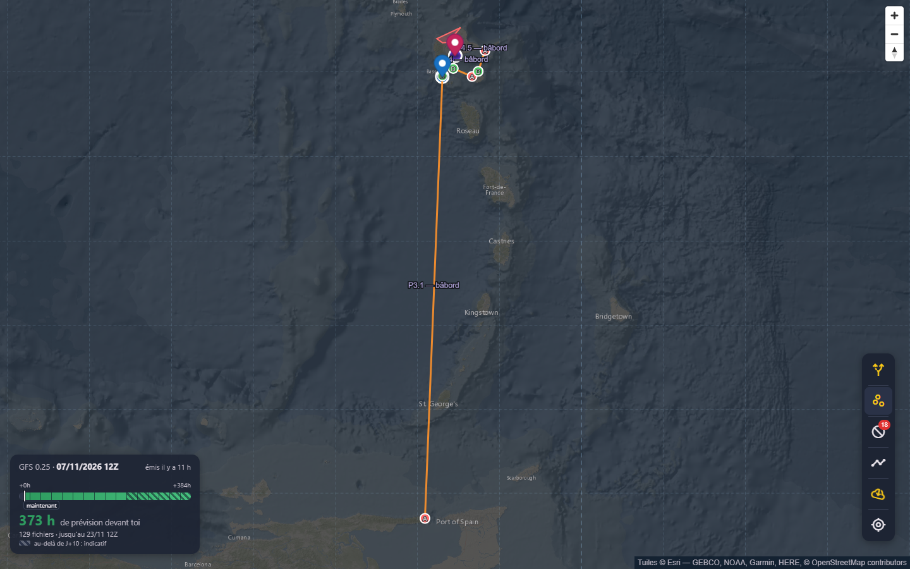
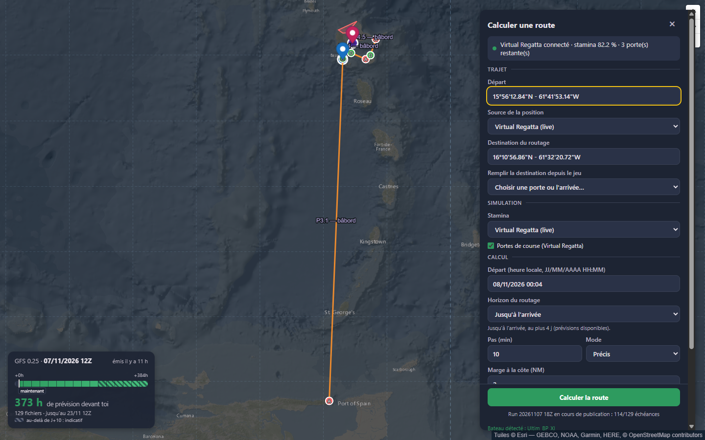
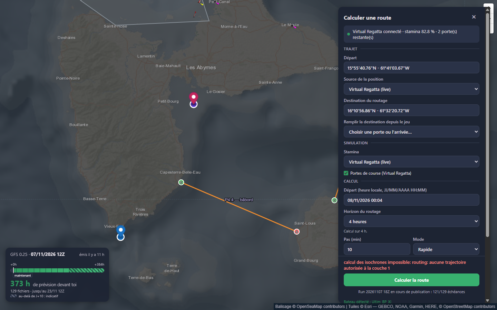
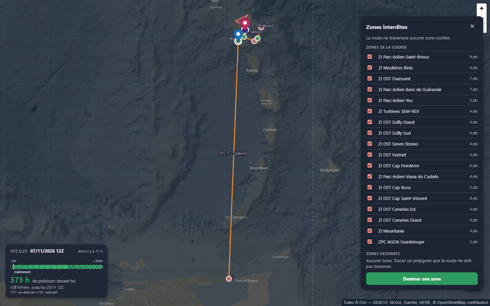
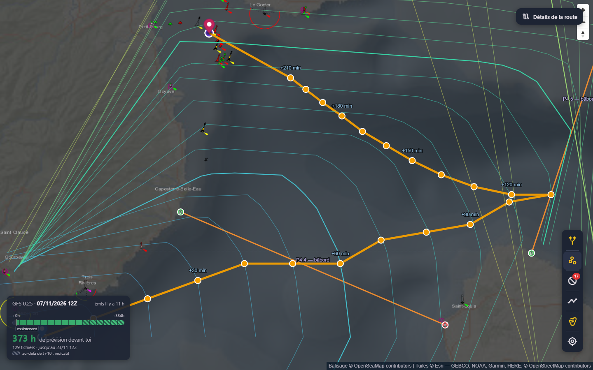
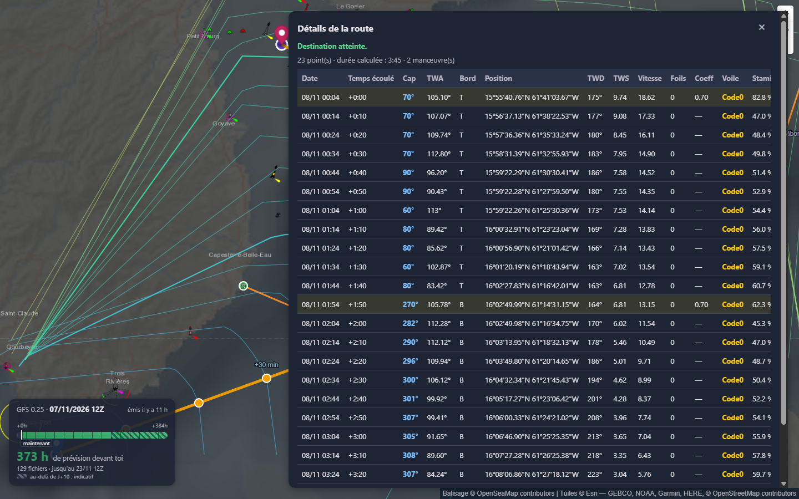
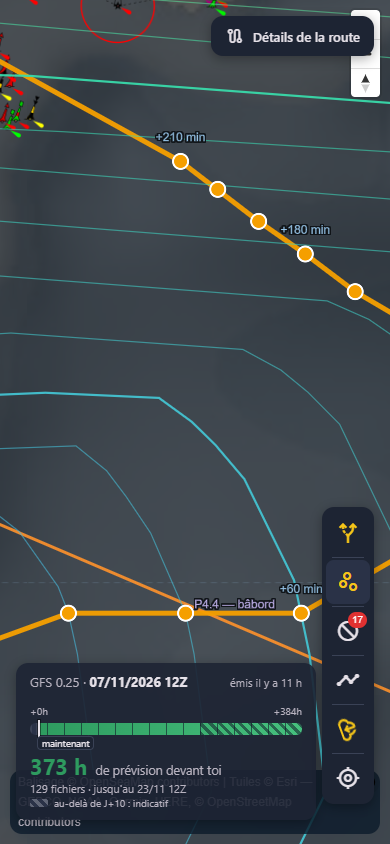
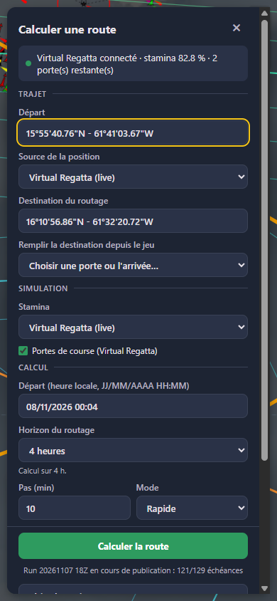

# Audit de l'interface — améliorations visuelles et manques

*Relevé le 8 novembre 2026 avec Playwright, sur la branche `feat/grib-watcher` (commit `a3fb7fe`).*

## Méthode

- Interface lancée en local (`vite`), reliée au vrai backend et à l'état Virtual Regatta en direct (Ultim BP XI au large de Vieux-Fort, Guadeloupe).
- Deux tailles d'écran : **1440 × 900** (ordinateur) et **390 × 844** (téléphone).
- Écrans parcourus : accueil, formulaire de calcul, zones interdites, calcul, route affichée, détails de la route.
- Trois calculs courts (4 heures, mode Rapide). Les réglages modifiés pour ces essais l'ont été dans le navigateur de test, pas dans le vôtre.
- La fenêtre de progression du calcul n'a pas pu être observée : les calculs de 4 heures se terminaient en 1 à 4 secondes.

Les captures sont dans [`docs/audit-interface/`](audit-interface/).

**Priorités :** **P1** bloque ou trompe l'utilisateur · **P2** gêne régulièrement · **P3** confort ou finition.

---

## État au 9 novembre 2026

**En bref :** tous les points P1, P2 et P3 sont traités, sauf un, remplacé par une autre solution (section 3). Il reste cinq nouvelles fonctions de la section 8.

Le relevé d'origine est conservé tel quel sous cette section. Les constats y décrivent l'interface du 8 novembre, pas l'interface actuelle.

**Légende :** ✅ fait · 🔁 fait autrement que proposé · ⬜ reste à faire

### Points P1 à P3

| Section | Point | État | Ce qui a été fait | Commit |
|---|---|---|---|---|
| 1 | Étiquettes des portes qui se chevauchent | ✅ | MapLibre place les noms autour du milieu de la porte et masque ceux qui se recouvrent | `24266d7` |
| 1 | Légende des repères | ✅ | Bouton « Légende » dans la barre d'outils, ouverte par défaut sur ordinateur, choix mémorisé | `24266d7`, `7e7ac51` |
| 1 | Commandes de carte en anglais | ✅ | Commandes en français, repères nommés pour les lecteurs d'écran | `24266d7` |
| 1 | Icône d'onglet | ✅ | Icône SVG (voiles) | `24266d7` |
| 1 | Tutoiement | ✅ | « devant vous » | `24266d7` |
| 1 | Run affiché différent du run utilisé | ✅ | L'encart affiche aussi le run en cours de téléchargement (« Run 18Z du 07/11 en cours 121/129 ») | `24266d7` |
| 2 | Panneau sur les boutons de zoom | ✅ | Zoom et boussole déplacés en haut à gauche | `24266d7` |
| 2 | « Bateau détecté » qui déborde | ✅ | Placé dans la section « Bateau », dans la zone qui défile | `ffde270` |
| 2 | Formulaire trop long | ✅ | Sections « Bateau » et « Réglages avancés » repliables, avec un résumé | `ffde270` |
| 2 | Format brut du run | ✅ | « Run 18Z du 07/11 » | `24266d7` |
| 2 | Mode séparé de l'horizon | ✅ | « Mode » placé juste avant « Horizon » | `ffde270` |
| 3 | Départ près de la côte impossible | ✅ | Le moteur laisse un bateau déjà dans la marge s'éloigner de la côte. Vérifié sur le vrai backend | `2da0422` |
| 3 | Message d'erreur technique | ✅ | Erreurs traduites en phrases qui disent quoi changer (marge, zone, départ) | `24266d7` |
| 3 | Vérification avant le calcul (« départ à 1,2 NM, sous la marge ») | 🔁 | Pas faite : le moteur accepte maintenant ce cas, le message n'aurait presque plus d'occasion de s'afficher | — |
| 4 | Panneau qui bloque la barre d'outils | ✅ | Les panneaux s'arrêtent avant la barre d'outils, un seul ouvert à la fois | `24266d7` |
| 4 | 18 zones de toute la course | ✅ | Tri par distance au bateau, zones à plus de 300 NM grisées, « Tout cocher / Tout décocher » | `24266d7` |
| 4 | Voir une zone sur la carte | ✅ | Un clic centre la carte sur la zone et la surligne en jaune | `24266d7` |
| 4 | « 9 pts » | ✅ | Remplacé par la distance au bateau | `24266d7` |
| 4 | Panneaux de tailles différentes | ✅ | Même position et même cadre pour les trois panneaux | `24266d7` |
| 5 | Encart météo sur le début de la route | ✅ | Le cadrage réserve la place de l'encart et de la légende, du côté qui coûte le moins de carte | `24266d7`, `7e7ac51` |
| 5 | Isochrones à travers les îles | ✅ | Contours coupés aux sauts anormaux | `24266d7` |
| 5 | « Détails de la route » sur le zoom | ✅ | Le zoom est passé à gauche, le bouton se masque quand un panneau est ouvert | `24266d7` |
| 5 | Balisage trop coloré | ✅ | Opacité réduite à 60 %, interrupteur dans la légende | `24266d7` |
| 5 | Points de route trop nombreux | ✅ | Seuls les manœuvres et les heures rondes restent dessinés, les autres apparaissent au survol | `91f7ddc` |
| 6 | Tableau qui déborde | ✅ | En-tête et colonne Date fixes, défilement dans le panneau | `24266d7` |
| 6 | Pas d'export | ✅ | « Exporter en GPX » et « Copier le tableau » | `24266d7` |
| 6 | Décimales à l'anglaise | ✅ | Virgule décimale, une décimale pour TWA, vent et vitesse | `24266d7` |
| 6 | Colonne Foils à 0 | ✅ | Foils et Coeff masquées quand elles ne varient pas | `24266d7` |
| 6 | Panneau qui couvre la carte | ✅ | Mode « Réduire au résumé » | `24266d7` |
| 6 | Stamina à vérifier dans le moteur | ✅ | Pas d'erreur : −35,8 est un changement de voile (20 × 1,5 × 1,19) et −17 un empannage (10 × 1,5 × 1,19). Un test fixe ces deux valeurs | `6df07df` |
| 7 | Encart météo sur l'attribution | ✅ | Encart réduit à une ligne sur téléphone, attribution repliée sur son bouton « i » | `24266d7` |
| 7 | « Détails de la route » sur le zoom | ✅ | Même correction que sur ordinateur | `24266d7` |
| 7 | Tableau inutilisable sur téléphone | ✅ | Une carte par étape ; toucher une étape réduit le panneau et montre sa position | `91f7ddc` |
| 7 | Carte grise sous le bouton du formulaire | ✅ | Même correction que « Bateau détecté » | `ffde270` |
| 9 | Commandes et repères annoncés en anglais | ✅ | Voir section 1 | `24266d7` |
| 9 | Infobulles absentes au toucher | ✅ | Un appui long sur un bouton de la barre d'outils affiche son libellé sans l'activer | `91f7ddc` |
| 9 | Contraste non mesuré | ✅ | Mesuré. Les textes gris passent (7,6:1). Quatre couleurs sous 4,5:1 ont été corrigées : heures de l'encart, boutons verts, badge GPX | `91f7ddc` |

### Nouvelles fonctions (section 8)

| # | Fonction | État |
|---|---|---|
| 1 | Vent sur la carte | ⬜ |
| 2 | Rejouer le calcul dans le temps | ⬜ |
| 3 | Exporter la route | ✅ GPX et tableau à coller dans un tableur (`24266d7`) |
| 4 | Comparer deux routes | ⬜ |
| 5 | Choisir le départ ou la destination en cliquant sur la carte | ⬜ |
| 6 | Légende | ✅ (`24266d7`, `7e7ac51`) |
| 7 | Messages d'erreur compréhensibles | ✅ (`24266d7`) |
| 8 | Historique des derniers calculs | ⬜ |

### Prochaines étapes

Les prochaines étapes viennent de [l'analyse de SERMAR](analyse-ihm-sermar.md) :

1. **Ordres à donner dans le jeu** : la route traduite en réglages à faire, aux bons moments.
2. **Carte de résultat compacte** : arrivée, durée, distance, manœuvres et stamina finale.

Le rejeu dans le temps (point 2 ci-dessus) et la comparaison de routes (point 4) correspondent à la frise temporelle et à la comparaison proposées dans cette analyse. Ils sont prévus après ces deux étapes.

---

## Les 5 points à traiter en premier

| # | Priorité | Problème | Écran |
|---|---|---|---|
| 1 | P1 | Calcul impossible avec le bateau près de la côte, et le message d'erreur n'explique rien | Formulaire |
| 2 | P1 | Les panneaux masquent les commandes de la carte et la barre d'outils | Tous |
| 3 | P1 | L'encart météo cache le début de la route, et se superpose à l'attribution sur mobile | Carte |
| 4 | P2 | Les contours d'isochrones traversent les îles | Route |
| 5 | P2 | Le tableau des détails déborde et la colonne Stamina est coupée | Détails |

---

## 1. Accueil et carte

**Ce qui fonctionne bien :** la carte marine de nuit est lisible, la route et les portes ressortent, la barre d'outils est compacte, et le badge rouge des zones (18) se voit tout de suite.

| Priorité | Constat | Suggestion |
|---|---|---|
| P2 | **Les étiquettes des portes se chevauchent et passent sous les épingles** : « 4.5 — bâbord » est coupé, « P4.4 » est caché par l'épingle rose. | Décaler les étiquettes et autoriser MapLibre à masquer celles qui se chevauchent (`text-allow-overlap: false`, `text-variable-anchor`), ou les placer au milieu de la porte, côté mer. |
| P2 | **Aucune légende des repères** : épingle bleue (départ), épingle rose (arrivée du jeu), cercle violet (destination du routage), pastilles D/A, couleur des portes (vert tribord, orange bâbord). Il faut deviner. | Ajouter une petite légende repliable près de l'encart météo. |
| P3 | **Commandes de carte en anglais** : « Zoom in », « Drag to rotate map », et les repères s'annoncent « Map marker » pour les lecteurs d'écran. | Passer l'option `locale` de MapLibre en français et donner un `title` ou un `aria-label` à chaque repère (« Départ », « Arrivée du jeu »…). |
| P3 | **Pas d'icône d'onglet** : erreur 404 sur `favicon.ico` dans la console. | Ajouter une icône (une voile ou une rose des vents). |
| P3 | **Le tutoiement côtoie le vouvoiement** : « 373 h de prévision devant toi », alors que le reste de l'interface vouvoie. | Harmoniser en « devant vous ». |
| P3 | **Run affiché différent du run utilisé** : l'encart montre « 07/11/2026 12Z » alors que le calcul utilise déjà le 18Z en cours de téléchargement (121/129 échéances). | Afficher les deux : « 12Z complet · 18Z en cours 121/129 ». |

---

## 2. Formulaire « Calculer une route »

**Ce qui fonctionne bien :** les sections (Trajet, Simulation, Calcul) sont claires, l'état Virtual Regatta est visible en tête, le bouton « Calculer la route » reste toujours visible en bas, et le bateau est détecté automatiquement.

| Priorité | Constat | Suggestion |
|---|---|---|
| **P1** | **Le panneau recouvre les boutons de zoom et la boussole** (en haut à droite, sous la barre de défilement). | Décaler les commandes MapLibre vers la gauche quand un panneau est ouvert, ou réserver une marge au panneau. |
| P2 | **« Bateau détecté : Ultim_BP_XI » déborde sous le panneau**, en vert, par-dessus l'attribution de la carte. | Le garder dans la zone qui défile, juste sous le choix de la polaire. |
| P2 | **Le formulaire est long** : il faut faire défiler pour voir la marge côtière, la polaire et les équipements. | Replier « Équipements » et « Polaire » dans une section « Bateau », fermée quand tout vient du jeu. |
| P3 | **Format du run brut** : « Run 20261107 18Z en cours de publication ». | Écrire « Run 18Z du 07/11 », comme dans le reste de l'interface. |
| P3 | **Mode et Pas sont séparés de l'horizon**, alors que le mode limite l'horizon (4 jours en Précis, 10 en Rapide). | Placer « Mode » avant « Horizon ». |

---

## 3. Calcul impossible près de la côte (P1)

**Constat :** le bateau se trouve contre la côte, à Vieux-Fort. Avec la marge côtière par défaut (2 NM) et toutes les zones du jeu actives, le calcul échoue aussitôt :

> calcul des isochrones impossible: routing: aucune trajectoire autorisée à la couche 1

Le calcul a réussi après **deux changements à la fois** : marge à 0 et zone « ZPC AGOA Guadeloupe » désactivée. Avec la zone seule désactivée, il échouait encore. La marge côtière est donc au moins en cause, mais je n'ai pas isolé l'effet de chacune.

**Pourquoi c'est important :** c'est la situation des départs et des arrivées de course. Le message est technique (« couche 1 », « trajectoire autorisée ») et ne dit pas quoi faire.

**Suggestions :**
1. Avant le calcul, vérifier si le départ est dans la marge côtière ou dans une zone interdite, et le dire clairement : « Le départ est à 1,2 NM de la côte, sous la marge de 2 NM. Réduisez la marge ou déplacez le départ. »
2. Côté moteur, autoriser un premier trajet qui **s'éloigne** de la côte ou de la zone, au lieu de tout refuser.
3. Traduire les erreurs du moteur en phrases d'utilisateur.

---

## 4. Zones interdites

**Ce qui fonctionne bien :** la liste est claire, chaque zone se coche ou se décoche, et le dessin d'une zone est proposé.

| Priorité | Constat | Suggestion |
|---|---|---|
| **P1** | **Le panneau bloque la barre d'outils** : impossible de cliquer sur « Calculer une route » tant qu'il est ouvert (Playwright l'a confirmé : le panneau intercepte le clic). | Placer les panneaux à gauche de la barre d'outils, ou les fermer automatiquement à l'ouverture d'un autre panneau. |
| P2 | **18 zones de toute la course, Europe comprise** (Ouessant, Fastnet, Canaries…), alors que le bateau est aux Antilles. | Trier par distance au bateau, griser les zones lointaines, ajouter « Tout cocher / Tout décocher ». |
| P2 | **Impossible de voir une zone sur la carte depuis la liste.** | Un clic sur le nom centre la carte sur la zone et la met en surbrillance. |
| P3 | « 9 pts » est du jargon. | Afficher la surface ou rien. |
| P3 | Ce panneau ne se place pas comme le formulaire : il commence plus bas, et sa hauteur est différente. | Uniformiser la position et la taille des panneaux. |

---

## 5. Route affichée

**Ce qui fonctionne bien :** isochrones en dégradé de couleur, repères de temps (+30 min, +60 min…), balisage OpenSeaMap visible en zoomant, bouton « Détails de la route ».

| Priorité | Constat | Suggestion |
|---|---|---|
| **P1** | **Le début de la route est caché par l'encart météo** (en bas à gauche). Le cadrage automatique ne tient compte que des panneaux de droite. | Ajouter la hauteur de l'encart à la marge du cadrage (`fitBounds`), ou réduire l'encart à un bouton une fois la route calculée. |
| P2 | **Les contours d'isochrones traversent Basse-Terre** : de longs traits partent du départ et coupent l'île. On croit voir des routes par la terre. | Couper le contour quand deux points voisins sont trop éloignés, ou ne tracer que les points du front. |
| P2 | **Le bouton « Détails de la route » recouvre les boutons de zoom.** | Le décaler sous la boussole, ou le mettre dans la barre d'outils. |
| P3 | **Le balisage est très coloré** à fort zoom et rivalise avec la route. | Ajouter un bouton pour l'afficher ou le masquer, ou baisser son opacité. |
| P3 | **Les points de route sont nombreux** (un toutes les 10 min). | Ne garder que ceux des manœuvres et des heures rondes, et les autres au survol. |

---

## 6. Détails de la route

**Ce qui fonctionne bien :** le tableau est complet (cap, TWA, bord, vent, vitesse, voile, stamina), les lignes de manœuvre sont surlignées, et le résumé (« 23 points · durée 3:45 · 2 manœuvres ») est utile.

| Priorité | Constat | Suggestion |
|---|---|---|
| P2 | **Le tableau déborde** (878 px pour 853 visibles) : la colonne Stamina est coupée (« 82.8 9 »). | Fixer la colonne Date à gauche et permettre le défilement horizontal, ou masquer les colonnes peu utiles. |
| P2 | **Pas d'export de la route**, alors que l'import GPX existe. | Ajouter « Exporter en GPX » et « Copier le tableau ». |
| P3 | **Décimales à l'anglaise** (« 105.10° », « 18.62 ») et précision variable (« 113° » à côté de « 105.10° »). | Virgule décimale, une seule décimale pour TWA, vitesse et vent. |
| P3 | **Colonne « Foils » à 0 partout** sur ce parcours. | La masquer quand elle ne varie pas. |
| P3 | **Le panneau couvre presque toute la carte.** | Option « réduire » qui ne laisse que le résumé, et lien entre une ligne et son point sur la carte. |

**À vérifier dans le moteur (pas un défaut d'affichage) :** la stamina passe de **82,8 % à 47,0 %** au premier pas de 10 minutes, soit −35,8 points pour une manœuvre au départ par vent de 9,7 nœuds. La seconde manœuvre, à +1:50, coûte −17 points. L'écart mérite un contrôle des coûts d'énergie du moteur (coût de base × coefficient Ultim 1,5 × facteur de vent).

---

## 7. Téléphone (390 × 844)

| Carte | Formulaire |
|---|---|
|  |  |

| Priorité | Constat | Suggestion |
|---|---|---|
| **P1** | **L'encart météo recouvre l'attribution de la carte** : les textes se superposent et deviennent illisibles. Il occupe aussi un quart de l'écran. | Sur petit écran, réduire l'encart à une ligne (« 12Z · 373 h ») qui s'ouvre au toucher. |
| P2 | **« Détails de la route » recouvre les boutons de zoom.** | Même correction que sur ordinateur. |
| P2 | **Le tableau des détails sera inutilisable** à cette largeur (13 colonnes, 878 px), sans que je l'aie testé ici. | Sur mobile, une carte par étape au lieu d'un tableau. |
| P3 | Le formulaire tient bien en plein écran, mais une carte grise apparaît sous le bouton, coupée en bas. | Même correction que « Bateau détecté » (section 2). |

---

## 8. Manques fonctionnels relevés

Fonctions absentes, qu'un utilisateur de routeur s'attend à trouver :

1. **Afficher le vent sur la carte** (flèches ou particules animées) : les GRIB sont déjà chargés.
2. **Rejouer le calcul dans le temps** : un curseur qui fait avancer le bateau et les isochrones heure par heure.
3. **Exporter la route** en GPX ou en CSV.
4. **Comparer deux routes** : modes, zones ou marges différents, superposés sur la carte.
5. **Choisir le départ ou la destination en cliquant sur la carte**. Je n'ai pas trouvé cette possibilité : la saisie se fait au format degrés-minutes-secondes.
6. **Légende** des repères et des couleurs (voir section 1).
7. **Messages d'erreur compréhensibles** et vérifications avant le calcul (voir section 3).
8. **Historique** des derniers calculs.

---

## 9. Accessibilité

- **Bien :** la langue de la page est le français (`lang="fr"`), les boutons de la barre d'outils ont des libellés, la fenêtre de calcul s'annonce (`role="status"`), et les champs ont leur étiquette.
- **À corriger :**
  - les commandes de carte s'annoncent en anglais, et les repères en « Map marker » ;
  - les boutons de la barre d'outils n'ont qu'une icône : les infobulles n'apparaissent qu'au survol, donc jamais au toucher ;
  - le texte gris clair sur gris foncé de l'encart météo et des notes, à 11 et 12 px, risque d'être trop peu contrasté (contraste non mesuré).

---

## Ordre de travail proposé

1. **Corriger les chevauchements** (points 2 et 3 du tableau de tête) : position des panneaux, commandes MapLibre, encart météo, cadrage de la route.
2. **Rendre le départ près de la côte calculable**, avec un message clair (section 3).
3. **Lisibilité de la carte** : étiquettes des portes, contours d'isochrones, légende.
4. **Tableau des détails** : débordement, format des nombres, export GPX.
5. **Mobile** : encart réduit, détails en cartes.
6. **Nouvelles fonctions** : vent sur la carte, rejeu dans le temps, comparaison de routes.
