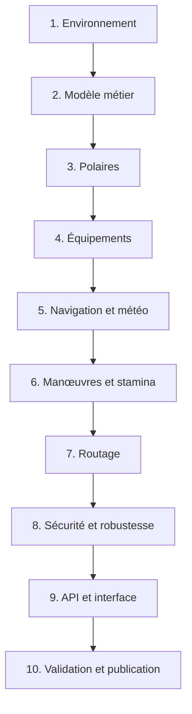

# Roadmap du routeur Virtual Regatta

## 1. Objectif du projet

Créer une application web de routage pour Virtual Regatta capable de :

- lire les prévisions météo GFS de la NOAA au format GRIB2 ;
- lire les polaires complètes des bateaux au format JSON ;
- calculer une route théorique visant le meilleur temps d'arrivée ;
- calculer une route pratique, sûre et stable pendant environ quatre heures sans intervention ;
- prendre en compte les voiles réellement disponibles, les équipements, le budget, les manœuvres et la stamina ;
- comparer les deux routes et recommander les équipements les plus utiles ;
- évoluer d'un usage personnel vers quelques testeurs, puis vers une application publique.

## 2. Décisions déjà prises

### Technologies

- Moteur de routage et serveur : **Go**.
- Interface web : **TypeScript**, **Vite** et **MapLibre**.
- Conteneurisation : **Docker** et **Docker Compose**.
- Base de données future : **PostgreSQL/PostGIS**.
- Extension future : **Chrome/Edge, Manifest V3**.
- Éditeur : **Visual Studio Code**.

### Fonctionnement du routeur

- Route théorique : interventions disponibles au moment optimal.
- Route pratique : environ quatre heures sans intervention.
- Aucun automatisme dans la première version de la route pratique :
  - pas de waypoint ;
  - pas de programmation de cap ;
  - pas de régulateur d'allure ;
  - pas de voile automatique.
- Priorité de la route pratique : sécurité, stabilité et faible sensibilité aux variations météo.

### Budget et équipements

- Le plafond de dépenses est saisi pour chaque course.
- Ce plafond est un budget total comprenant le bonus de départ.
- Le budget dépend de la catégorie de course.
- L'alerte radio et la couleur sont exclues de l'optimisation pour l'instant.
- Les options de performance étudiées sont :
  - Light ;
  - Heavy ;
  - Code0 ;
  - foils ;
  - polish de coque ;
  - winchs pro.
- Avec six options binaires, le moteur peut tester au maximum 64 configurations.

### Correspondance des voiles

- Voiles de base : `Jib` et `Spi`.
- Option Light : `LightJib` et `LightGnk`.
- Option Heavy : `Staysail` et `HeavyGnk`.
- Option Code0 : `Code0`.

Cette correspondance est résolue par les noms de voiles présents dans chaque polaire, sans figer leurs identifiants numériques.

### Stamina et manœuvres

- Énergie initiale : 100 %.
- Changement de cap simple : 0 % de consommation de référence.
- Virement : 10 %.
- Empannage : 10 %.
- Changement de voile : 20 %.
- La consommation dépend également du vent et du bateau.
- La stamina se régénère pendant les périodes sans manœuvre.
- L'énergie disponible modifie la durée des manœuvres.
- Les winchs pro réduisent le ralentissement et le temps de manœuvre.

## 3. Vue d'ensemble des phases



## Phase 0 — Consolider les règles et les données

**Statut : en cours**

### Objectif

Réunir les données nécessaires et séparer les règles permanentes des règles variables selon la course.

### Tâches

- [x] Examiner la polaire `ultim_bp_11.json`.
- [x] Vérifier les dimensions des matrices : 29 TWA × 18 TWS pour chacune des 7 voiles.
- [x] Examiner un fichier GFS GRIB2 contenant U et V à 10 mètres.
- [x] Formaliser les coûts par catégorie de course.
- [x] Définir le budget comme un plafond total saisi par course.
- [x] Définir les deux modes de routage.
- [x] Confirmer la correspondance entre l'option Light et les voiles du JSON.
- [x] Confirmer la correspondance entre l'option Heavy et les voiles du JSON.
- [ ] Compléter les coûts et effets des équipements manquants.
- [ ] Transcrire précisément les courbes de stamina depuis les graphiques officiels.
- [ ] Déterminer comment Virtual Regatta combine deux manœuvres simultanées.

### Livrable

Un fichier de configuration de course indépendant du moteur de calcul.

### Critère de validation

Une course peut être décrite sans modifier le code Go : catégorie, budget, voiles gratuites, équipements, coûts et règles particulières.

## Phase 1 — Préparer l'environnement Go et Docker

**Statut : terminée**

### Objectif

Obtenir un environnement reproductible sur Windows, chez les testeurs et sur le futur serveur.

### Tâches

- [x] Installer ou vérifier Docker Desktop.
- [x] Installer les extensions VS Code Go, Container Tools et Dev Containers.
- [x] Créer le dépôt Git du projet.
- [x] Créer l'arborescence `backend`, `frontend`, `extension` et `data`.
- [x] Initialiser le module Go.
- [x] Créer le premier `Dockerfile` multi-stage.
- [x] Créer `compose.yaml`.
- [ ] Créer éventuellement `.devcontainer/devcontainer.json`.
- [x] Lancer un serveur HTTP Go minimal dans Docker.
- [x] Ajouter une première commande de test.

### Livrable

Une image `vr-router-backend` lançant une API Go minimale sur le port 8080.

### Critère de validation

La commande `docker compose up` démarre le serveur et une route `/health` répond correctement.

## Phase 2 — Définir le modèle métier

**Statut : en cours**

### Objectif

Créer les structures utilisées par tous les modules sans les lier à l'interface web ou à une bibliothèque GRIB particulière.

### Tâches

- [ ] Définir `Position`, `Wind`, `Heading` et `TimeStep`.
- [x] Définir `Polar`, `Sail`, `Foil`, `Hull` et `Winch`.
- [x] Définir `RaceConfiguration`, `RaceBudget` et `Equipment`.
- [x] Définir `BoatState`, `StaminaState` et `ManeuverState`.
- [ ] Définir `RouteRequest`, `RouteNode` et `RouteResult`.
- [ ] Définir les interfaces `WeatherProvider`, `PolarProvider`, `Constraint` et `Router`.
- [x] Définir les erreurs métier et les règles de validation des polaires.

### Livrable

Un package Go contenant les types centraux et leurs tests unitaires.

### Critère de validation

Les données d'une course et l'état d'un bateau peuvent être représentés sans dépendre de Docker, de MapLibre ou de Virtual Regatta.

## Phase 3 — Charger et interpoler les polaires

**Statut : terminée**

### Objectif

Calculer la vitesse du bateau pour une force de vent, un angle et une liste de voiles disponibles.

### Tâches

- [x] Créer les structures JSON correspondant à `ultim_bp_11.json`.
- [x] Charger et valider le fichier.
- [x] Vérifier l'ordre et les dimensions TWA/TWS.
- [x] Développer l'interpolation bilinéaire TWA/TWS.
- [x] Calculer la vitesse de chaque voile disponible.
- [x] Choisir la meilleure voile autorisée.
- [x] Appliquer le ratio global du bateau.
- [x] Appliquer le polish de coque.
- [x] Appliquer progressivement le bonus des foils.
- [x] Tester les valeurs exactes de la grille et les valeurs interpolées.

### Livrable

Une fonction du type :

```go
performance, err := polar.BestEffectiveSailAt(tws, twa, availableSails, options)
```

### Critère de validation

Le moteur retrouve les valeurs exactes du JSON sur les points connus et produit des transitions continues entre ces points.

## Phase 4 — Optimiser les équipements et le budget

**Statut : en cours**

### Objectif

Comparer toutes les configurations d'équipement respectant le plafond saisi.

### Tâches

- [x] Modéliser les catégories de course de 6 à 1.
- [x] Implémenter le coefficient `7 - catégorie`.
- [x] Calculer le bonus de départ.
- [x] Enregistrer les coûts de base Light, Heavy, Code0, foils, polish et winchs pro.
- [x] Distinguer bonus utilisé et crédits personnels nécessaires.
- [x] Générer les 64 configurations possibles.
- [x] Éliminer les configurations dépassant le plafond.
- [x] Gérer les équipements déjà possédés lors d'un calcul en mer.
- [ ] Gérer l'achat recommandé avant et pendant la course.
- [ ] Classer les configurations selon l'heure d'arrivée théorique et pratique.
- [x] Afficher le gain marginal instantané de chaque achat.

### Livrable

Une liste classée de configurations valides avec coût, contribution personnelle et gain estimé.

### Critère de validation

Le moteur ne dépasse jamais le plafond et retrouve les montants du tableau de référence pour chaque catégorie.

> Le classement actuel mesure la performance pour un vent donné. Le classement par heure d'arrivée restera à intégrer au moteur de routage.

## Phase 5 — Développer les calculs de navigation

**Statut : terminée**

### Objectif

Simuler précisément le déplacement d'un bateau sur le globe.

### Tâches

- [x] Calculer la distance entre deux coordonnées.
- [x] Calculer le cap initial vers une destination.
- [x] Calculer une nouvelle position après un déplacement.
- [x] Convertir nœuds, mètres par seconde, milles nautiques et secondes.
- [x] Gérer le passage de l'antiméridien.
- [x] Gérer les longitudes NOAA de 0° à 359,75°.
- [x] Calculer la direction du vent à partir de U et V.
- [x] Calculer le TWA entre le cap et le vent.
- [x] Identifier l'amure du bateau.
- [x] Écrire des tests géographiques de référence.

### Livrable

Un package `navigation` déterministe et testé.

### Critère de validation

Les résultats de distance, cap et déplacement correspondent à des cas de référence connus avec une tolérance définie.

## Phase 6 — Lire et interpoler la météo GRIB2

**Statut : en cours**

### Objectif

Connaître le vent à n'importe quelle position et heure couverte par les prévisions NOAA.

### Données déjà observées

- GRIB2 NOAA GFS.
- Résolution mondiale de 0,25°.
- Grille de 1 440 × 721 points.
- Composantes U et V à 10 mètres.
- Série réelle validée : run `20260905/06`, échéances `f000`, `f003` et `f006`.
- Modèles GRIB2 observés : grille 3.0, produit 4.0 et représentation 5.3.
- Lecteur natif Go retenu : `github.com/skysparq/grib2-go`.

### Tâches

- [x] Créer `GRIB2WeatherProvider` derrière l'interface `WeatherProvider`.
- [x] Tester un lecteur GRIB2 natif Go sur le fichier fourni.
- [ ] Comparer quelques valeurs décodées avec un outil de référence.
- [x] Extraire U et V à 10 mètres.
- [x] Charger une série d'échéances `f000`, `f003`, `f006`, etc.
- [x] Interpoler spatialement U et V.
- [x] Interpoler temporellement entre deux échéances.
- [x] Calculer force et direction du vent.
- [x] Convertir les mètres par seconde en nœuds.
- [ ] Mettre en cache les grilles décodées.
- [ ] Stocker les GRIB dans un volume Docker.
- [x] Prévoir un téléchargement NOAA indépendant du moteur de routage.

### Livrable

Une fonction du type :

```go
wind, err := weather.WindAt(latitude, longitude, instant)
```

### Critère de validation

Les valeurs interpolées sont continues dans l'espace et le temps et concordent avec les valeurs de référence.

## Phase 7 — Modéliser les manœuvres et la stamina

**Statut : en cours**

### Objectif

Calculer le véritable coût d'une transition de cap ou de voile.

Le modèle sépare la manœuvre nautique du changement de voile afin de
représenter les actions simultanées sans figer leur règle de cumul.

### Tâches

- [x] Distinguer changement de cap simple, virement et empannage.
- [x] Détecter un changement de voile.
- [x] Interpoler le temps de manœuvre entre vent faible et vent fort.
- [x] Appliquer les ratios des winchs standard et pro.
- [x] Calculer la consommation d'énergie selon la manœuvre.
- [x] Appliquer le coefficient de vent à la consommation.
- [x] Calculer la récupération d'énergie pendant les périodes calmes.
- [x] Calculer l'effet de l'énergie sur la durée de la manœuvre.
- [x] Maintenir la stamina entre 0 % et 100 %.
- [x] Tester les manœuvres isolées et successives.
- [x] Rendre les courbes configurables pour suivre les évolutions du jeu.

### Livrable

Un `TransitionEvaluator` renvoyant durée, ralentissement, énergie consommée et nouvel état du bateau.

### Critère de validation

Les durées et consommations correspondent aux règles connues et évoluent continûment avec le vent et la stamina.

## Phase 8 — Construire le moteur de routage par isochrones

**Statut : en cours**

### Objectif

Calculer une route complète dans une météo qui évolue avec le temps.

### Tâches

- [x] Définir le pas de temps du calcul.
- [x] Générer plusieurs caps depuis chaque état.
- [x] Déplacer le bateau selon météo, polaire et équipement.
- [ ] Conserver cap, voile, stamina, amure et parent dans chaque nœud.
- [x] Découper le front d'isochrones en secteurs.
- [ ] Supprimer les états dominés sans supprimer des réserves de stamina utiles.
- [x] Détecter l'arrivée.
- [x] Reconstruire la route depuis les parents.
- [ ] Retourner caps, voiles, manœuvres et heures.
- [x] Exporter la route en GeoJSON.
- [x] Ajouter l'annulation et la progression d'un calcul.

### État actuel

Le routage en pleine mer produit des fronts successifs, reconstruit la meilleure
route et limite adaptativement leur taille. Sur le scénario réel de référence
de quatre heures, la limite de 500 candidats réduit le temps de calcul de
24,832 s à 9,600 s, avec une perte de progression de 0,783 NM.

### Livrable

Un premier routage en pleine mer, sans gestion des terres.

### Critère de validation

Le moteur atteint une destination simple et améliore le temps par rapport à une route directe dans une météo de test.

## Phase 9 — Ajouter les terres et les contraintes de course

**Statut : à faire**

### Objectif

Éliminer toute route invalide ou dangereuse.

### Tâches

- [ ] Choisir une source de côtes et de terres.
- [ ] Détecter l'intersection d'un segment avec la terre.
- [ ] Ajouter une marge côtière configurable.
- [ ] Gérer les îles et détroits.
- [ ] Gérer les portes, bouées et sens de franchissement.
- [ ] Gérer les zones d'exclusion.
- [ ] Tester les cas proches de la côte et de l'antiméridien.

### Livrable

Un moteur respectant le parcours et les zones interdites.

### Critère de validation

Aucun segment proposé ne traverse une terre ou une zone interdite et toutes les marques obligatoires sont validées.

## Phase 10 — Comparer route théorique et route pratique

**Statut : à faire**

### Objectif

Produire deux stratégies compréhensibles et comparables.

### Route théorique

- Interventions possibles au meilleur moment.
- Meilleure voile à chaque instant.
- Objectif principal : heure d'arrivée minimale.

### Route pratique

- Cap et voile fixes pendant environ quatre heures.
- Aucun automatisme dans la première version.
- Marge côtière renforcée.
- Préservation de la stamina.
- Faible sensibilité aux variations du vent.
- Situation facile à reprendre à la prochaine connexion.

### Tâches

- [ ] Définir le score de stabilité.
- [ ] Simuler de petites variations de force et de direction du vent.
- [ ] Rejeter les trajectoires trop sensibles.
- [ ] Calculer l'autonomie sans intervention.
- [ ] Comparer heure d'arrivée, manœuvres, stamina et risque.
- [ ] Expliquer le compromis entre les deux résultats.

### Livrable

Un rapport comparatif pour chaque calcul de route.

### Critère de validation

La route pratique reste sûre et raisonnablement performante pendant quatre heures sans action du joueur.

## Phase 11 — Créer l'API, les workers et l'interface web

**Statut : à faire**

### Objectif

Rendre le moteur utilisable depuis un navigateur et préparer plusieurs calculs simultanés.

### Backend Go

- [ ] Créer les routes de consultation des polaires et de la météo.
- [ ] Créer la demande de routage.
- [ ] Créer la consultation de progression et de résultat.
- [ ] Créer l'optimisation d'équipement.
- [ ] Valider toutes les entrées.
- [ ] Créer un pool de workers avec goroutines et channels.
- [ ] Utiliser la même image Docker Go pour l'API et les workers.

### Interface web

- [ ] Initialiser TypeScript et Vite.
- [ ] Intégrer MapLibre.
- [ ] Saisir départ, arrivée et heure.
- [ ] Saisir catégorie et plafond total.
- [ ] Sélectionner les équipements déjà possédés.
- [ ] Saisir cap, voile et stamina actuels.
- [ ] Afficher le vent et les isochrones.
- [ ] Afficher les deux routes.
- [ ] Comparer les équipements et les crédits.
- [ ] Afficher la prochaine intervention recommandée.

### Livrable

Une application web locale complète exécutée avec Docker Compose.

### Critère de validation

Un utilisateur peut configurer une course, lancer un calcul et comparer les deux routes dans son navigateur.

## Phase 12 — Tester, optimiser et ouvrir aux testeurs

**Statut : à faire**

### Objectif

Vérifier l'exactitude, la stabilité et les performances avant l'ouverture publique.

### Tâches

- [ ] Ajouter des tests unitaires, d'intégration et de non-régression.
- [ ] Comparer les vitesses calculées avec le jeu.
- [ ] Comparer des positions simulées après plusieurs heures.
- [ ] Vérifier les temps de manœuvre et la stamina.
- [ ] Créer des benchmarks Go.
- [ ] Utiliser `pprof` pour identifier les calculs coûteux.
- [ ] Tester plusieurs routages simultanés.
- [ ] Ajouter PostgreSQL/PostGIS lorsque nécessaire.
- [ ] Ajouter les comptes et l'historique.
- [ ] Faire tester l'application par deux ou trois personnes.
- [ ] Corriger les écarts et documenter les limites.

### Livrable

Une version bêta privée, reproductible et mesurée.

### Critère de validation

Les testeurs obtiennent des résultats cohérents, les erreurs sont traçables et le serveur supporte la charge prévue.

## Phase 13 — Extension et ouverture publique

**Statut : ultérieur**

### Objectif

Simplifier la récupération des données autorisées et exploiter l'application publiquement.

### Extension Chrome/Edge

- [ ] Créer une extension Manifest V3 séparée de Docker.
- [ ] Récupérer uniquement les données explicitement autorisées.
- [ ] Envoyer la position et l'état du bateau vers le routeur.
- [ ] Ne pas intercepter les protocoles ou envoyer des ordres sans autorisation officielle.
- [ ] Conserver la saisie manuelle comme solution de secours.

### Publication

- [ ] Ajouter l'authentification.
- [ ] Ajouter quotas et limites de calcul.
- [ ] Sécuriser l'API et les secrets.
- [ ] Ajouter journaux, métriques et surveillance.
- [ ] Sauvegarder la base de données.
- [ ] Versionner les règles, polaires et configurations de course.
- [ ] Automatiser la récupération des prévisions NOAA.
- [ ] Déployer les images Docker.

### Livrable

Une application publique maintenable avec une extension optionnelle conforme aux autorisations obtenues.

## 4. Ordre de réalisation immédiat

1. Phase 1 : environnement Go, Docker et VS Code.
2. Phase 2 : modèles métier.
3. Phase 3 : lecteur et interpolateur de polaire.
4. Phase 4 : coûts et configurations d'équipement.
5. Phase 5 : calculs de navigation.
6. Phase 6 : lecture et interpolation GRIB2.
7. Phase 7 : manœuvres et stamina.
8. Phase 8 : premier routage en pleine mer.

## 5. Définition de la première version utile

La première version utile, avant la carte complète, devra pouvoir recevoir :

```text
Position de départ
Destination
Date et heure
Catégorie de course
Plafond total de crédits
Voiles gratuites et achetées
Stamina initiale
Fichiers météo GFS
Polaire du bateau
```

Elle devra retourner :

```text
Configuration d'équipement recommandée
Route théorique
Route pratique sur quatre heures
Caps et voiles successifs
Manœuvres prévues
Évolution de la stamina
Heures d'arrivée estimées
Écart entre les deux stratégies
```

## 6. Principes de développement

- Avancer par petites fonctions testables.
- Valider les calculs avant de créer une interface complexe.
- Garder les règles du jeu configurables.
- Mesurer les performances avant d'optimiser.
- Séparer le moteur, les sources de données et l'interface.
- Conserver une saisie manuelle indépendante de Virtual Regatta.
- Documenter chaque formule et son origine.
- Comparer régulièrement les résultats avec le jeu.
